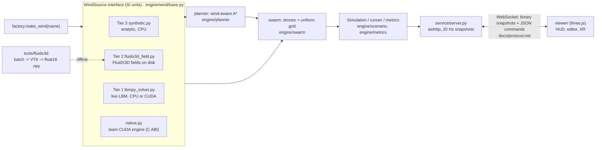

# AeroSwarm

Wind-aware drone-swarm simulator for the RVCE PAGP + CGVR course. An urban wind field (lattice-Boltzmann CFD or an analytic model)
drives a swarm of delivery drones that compares **naive** routing with **wind-aware** routing. A browser viewer (Vite + three.js)
shows the city, wind slice, tracers and drones, supports live building edits and a WebXR drone's-eye view.

> This is the **fallback baseline**: a complete, demo-ready system built from open-source parts behind one interface, so the team's own
> CUDA engine can be swapped in later (`docs/LINKING_GUIDE.md`). New to the project? Read **`docs/TEAM_GUIDE.md`** first.

## Quick start (any laptop, no GPU needed)

```bash
git clone <this repo> && cd aeroswarm
python3.11 -m venv .venv && source .venv/bin/activate          # Windows: .venv\Scripts\activate
pip install -r requirements.txt                                # exact tested versions: requirements.lock
python -m pytest -m "not gpu and not fluidx3d"                  # CPU suite (a few minutes; GPU tests skip cleanly)
python -m service.server --scenario scenarios/block_small.json --wind synthetic
# open http://127.0.0.1:8080   (viewer/dist is committed; rebuild: cd viewer && npm ci && npm run build)
```
Headless run + comparison: `python -m engine.scenario.runner scenarios/block_small.json --wind synthetic --routing aware --seed 1 --headless --duration 300`
(writes `runs/<timestamp>.../{config.json,metrics.csv,summary.json,replay.bin}`), `python -m engine.scenario.compare runs/A runs/B`.

**NVIDIA Windows laptop** (CUDA, FluidX3D, lbmpy on GPU, XR): follow `HANDOFF_WINDOWS.md`; paste `prompts/WINDOWS_AGENT_PROMPT.md` into your coding agent.

## Architecture


Rule: no module except the wind adapters knows which tier runs; swapping tiers is one config value (`--wind synthetic|fluidx3d|lbmpy|native`).

## Wind tiers

| Tier | Source | Live building edits | GPU LBM? | Runs here | Status |
|------|--------|--------------------|----------|-----------|--------|
| 3 | analytic log-law + building wakes/speed-up (`synthetic`) | yes, instant | no | any CPU | complete, default |
| 2 | FluidX3D, run offline per layout x direction (`fluidx3d`) | pick from the precomputed menu (nearest preset) | yes (offline, OpenCL) | needs `data/fields/` | pipeline complete and verified on real CFD (Mac GPU); full 3 x 8 set to be generated on the NVIDIA laptop |
| 1 | lbmpy D3Q19 + Smagorinsky (`lbmpy`) | yes: second solver settles, then swaps | yes (cupy) | CPU target works (coarse grid on the Mac) | CPU path tested; CUDA path written, tests `-m gpu` pending on Windows |
| - | team CUDA engine via `native/aeroswarm_native.h` | yes | yes | - | ABI + adapter + mock engine done; the real engine is the team's work |

## What is where

```
engine/        backend.py (xp = cupy|numpy) - wind/ (4 adapters + factory) - swarm/ - planner/ - scenario/ - metrics/ - protocol.py
service/       server.py (aiohttp, /ws, serves viewer/dist), edit.py (edit validation), tracers.py
viewer/        Vite + three.js: layers/ (drones LOD, tracer trails, wind slice), editor.js, xr.js, rig.js; dist/ is committed
tools/         fluidx3d/ (case gen, setup.cpp.template, batch, VTK converter), make_scenarios.py, compare_winds.py, demo_check.py
bench/         mlups.py, fluidx3d_bench.py, swarm_bench.py          experiments/  run_experiments.py (+ results/mac)
native/        aeroswarm_native.h (C ABI) + mock/aero_mock.c        scripts/windows/  PowerShell setup/verify/test/bench/demo
tests/         pytest (markers: gpu, fluidx3d, slow) + tests/validation (D2Q9 cylinder, collision conservation) + viewer vitest
docs/          protocol.md, TEAM_GUIDE.md, LINKING_GUIDE.md, xr.md, fluidx3d_mac.md, the build guide (md/ is generated)
```
Tests: `pytest -m "not gpu and not fluidx3d"` (CPU), `pytest -m gpu` (needs CUDA), `pytest -m fluidx3d` (needs an OpenCL device; builds FluidX3D), `cd viewer && npm test`.

## Results so far (Mac, no CUDA - "CPU tiers only")
See `experiments/results/mac/RESULTS.md` (generated) - naive vs wind-aware over 5 seeds x 3 layouts on Tier 3, Tier 2 and Tier 1,
and `experiments/results/mac/*.csv` for MLUPS. The headline numbers are copied into `docs/TEAM_GUIDE.md` section 3.
Each table names the wind tier that produced it; **Tier 2 output is FluidX3D's, not the team's own kernels.**

| check | result |
|-------|--------|
| D2Q9 cylinder Strouhal (numpy baseline / lbmpy CPU) | 0.163 / 0.181 (window 0.16-0.22) |
| collision conserves mass + momentum (float32) | pass (<= 1e-6) |
| uniform-grid neighbour search == naive (2k drones) | pass, exact |
| same scenario + seed -> identical metrics | pass (naive and aware) |
| service start-up | 0.4 s (< 30 s); tick 13-16 ms with 8k tracers (1k-drone scenario included) |
| Tier 2 FluidX3D on the Mac GPU | 4 real production jobs (7.4 M cells, 44 k steps each, ~5 min) |
| Tier 2 vs Tier 1 wind comparison | rel L2 0.17, corr 0.93 -> within the default swap tolerance |

## Credits and licences
See `CREDITS.md` (FluidX3D is non-commercial / altered-source rules; lbmpy and pystencils are GPL-3.0-or-later).
