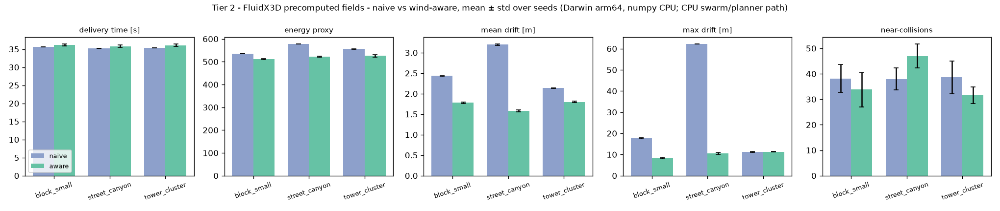
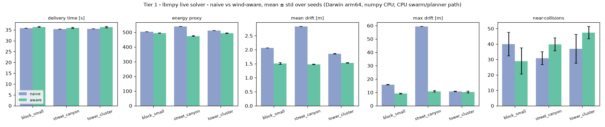
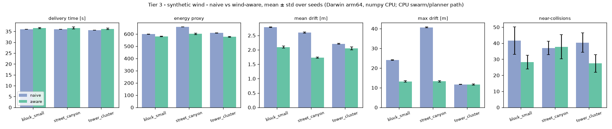

# Naive vs wind-aware routing - results (Darwin arm64, numpy CPU)

> **CPU tiers only.** Produced on a Mac without CUDA: the swarm, planner and metrics ran on the numpy/CPU path. Tier 2 fields were computed by FluidX3D (OpenCL, Apple GPU) offline; Tier 1 is lbmpy's *CPU* target on a coarse grid. GPU-tier numbers come from the Windows runs (see `HANDOFF_WINDOWS.md`).

seeds [1, 2, 3, 4, 5], duration cap 300 s, 9 (tier x layout) conditions, wall 1.8 min. Seeds vary mission start times and the wind's initial phase. Paired differences are aware - naive, per seed, 95% CI over seeds (t-interval).

## Tier 2 - FluidX3D precomputed fields

| layout | metric | naive | aware | aware-naive | ±95% CI | change | significant |
|---|---|---:|---:|---:|---:|---:|:--:|
| block_small | delivery time [s] | 35.67 | 36.19 | +0.52 | 0.34 | +1.5% | yes |
| block_small | energy proxy | 535.52 | 511.35 | -24.17 | 3.20 | -4.5% | yes |
| block_small | mean drift [m] | 2.43 | 1.78 | -0.65 | 0.03 | -26.8% | yes |
| block_small | max drift [m] | 17.70 | 8.40 | -9.30 | 0.42 | -52.5% | yes |
| block_small | near-collisions | 38.20 | 33.80 | -4.40 | 12.97 | -11.5% | no |
| street_canyon | delivery time [s] | 35.21 | 35.81 | +0.61 | 0.39 | +1.7% | yes |
| street_canyon | energy proxy | 577.84 | 521.89 | -55.95 | 2.53 | -9.7% | yes |
| street_canyon | mean drift [m] | 3.20 | 1.58 | -1.61 | 0.02 | -50.5% | yes |
| street_canyon | max drift [m] | 62.20 | 10.46 | -51.74 | 0.57 | -83.2% | yes |
| street_canyon | near-collisions | 38.00 | 47.00 | +9.00 | 8.75 | +23.7% | yes |
| tower_cluster | delivery time [s] | 35.41 | 36.09 | +0.68 | 0.44 | +1.9% | yes |
| tower_cluster | energy proxy | 555.65 | 525.93 | -29.73 | 5.77 | -5.3% | yes |
| tower_cluster | mean drift [m] | 2.14 | 1.80 | -0.34 | 0.02 | -16.0% | yes |
| tower_cluster | max drift [m] | 11.28 | 11.32 | +0.04 | 0.24 | +0.4% | no |
| tower_cluster | near-collisions | 38.60 | 31.60 | -7.00 | 5.90 | -18.1% | yes |

## Tier 1 - lbmpy live solver

| layout | metric | naive | aware | aware-naive | ±95% CI | change | significant |
|---|---|---:|---:|---:|---:|---:|:--:|
| block_small | delivery time [s] | 35.73 | 36.32 | +0.59 | 0.23 | +1.7% | yes |
| block_small | energy proxy | 503.93 | 494.36 | -9.57 | 0.94 | -1.9% | yes |
| block_small | mean drift [m] | 2.06 | 1.51 | -0.55 | 0.04 | -26.9% | yes |
| block_small | max drift [m] | 15.76 | 9.08 | -6.67 | 0.48 | -42.3% | yes |
| block_small | near-collisions | 40.00 | 29.00 | -11.00 | 17.11 | -27.5% | no |
| street_canyon | delivery time [s] | 35.40 | 35.91 | +0.51 | 0.35 | +1.4% | yes |
| street_canyon | energy proxy | 539.51 | 474.22 | -65.29 | 2.74 | -12.1% | yes |
| street_canyon | mean drift [m] | 2.83 | 1.48 | -1.35 | 0.01 | -47.8% | yes |
| street_canyon | max drift [m] | 59.37 | 10.82 | -48.55 | 0.62 | -81.8% | yes |
| street_canyon | near-collisions | 30.80 | 39.80 | +9.00 | 8.52 | +29.2% | yes |
| tower_cluster | delivery time [s] | 35.49 | 36.25 | +0.76 | 0.43 | +2.2% | yes |
| tower_cluster | energy proxy | 511.31 | 493.56 | -17.76 | 2.76 | -3.5% | yes |
| tower_cluster | mean drift [m] | 1.85 | 1.53 | -0.33 | 0.01 | -17.6% | yes |
| tower_cluster | max drift [m] | 10.71 | 10.33 | -0.37 | 0.88 | -3.5% | no |
| tower_cluster | near-collisions | 37.00 | 47.40 | +10.40 | 8.46 | +28.1% | yes |

## Tier 3 - synthetic wind

| layout | metric | naive | aware | aware-naive | ±95% CI | change | significant |
|---|---|---:|---:|---:|---:|---:|:--:|
| block_small | delivery time [s] | 35.99 | 36.49 | +0.50 | 0.32 | +1.4% | yes |
| block_small | energy proxy | 598.60 | 579.72 | -18.88 | 4.19 | -3.2% | yes |
| block_small | mean drift [m] | 2.79 | 2.10 | -0.69 | 0.05 | -24.8% | yes |
| block_small | max drift [m] | 24.09 | 13.18 | -10.90 | 0.47 | -45.3% | yes |
| block_small | near-collisions | 41.60 | 28.20 | -13.40 | 13.75 | -32.2% | no |
| street_canyon | delivery time [s] | 35.94 | 36.60 | +0.66 | 0.63 | +1.8% | yes |
| street_canyon | energy proxy | 657.95 | 600.73 | -57.22 | 6.77 | -8.7% | yes |
| street_canyon | mean drift [m] | 2.60 | 1.73 | -0.87 | 0.02 | -33.5% | yes |
| street_canyon | max drift [m] | 40.68 | 13.27 | -27.41 | 0.37 | -67.4% | yes |
| street_canyon | near-collisions | 37.00 | 37.80 | +0.80 | 12.51 | +2.2% | no |
| tower_cluster | delivery time [s] | 35.59 | 36.15 | +0.56 | 0.45 | +1.6% | yes |
| tower_cluster | energy proxy | 608.48 | 577.38 | -31.10 | 4.89 | -5.1% | yes |
| tower_cluster | mean drift [m] | 2.21 | 2.05 | -0.16 | 0.06 | -7.2% | yes |
| tower_cluster | max drift [m] | 11.66 | 11.66 | -0.00 | 0.53 | -0.0% | no |
| tower_cluster | near-collisions | 40.40 | 27.40 | -13.00 | 8.48 | -32.2% | yes |

